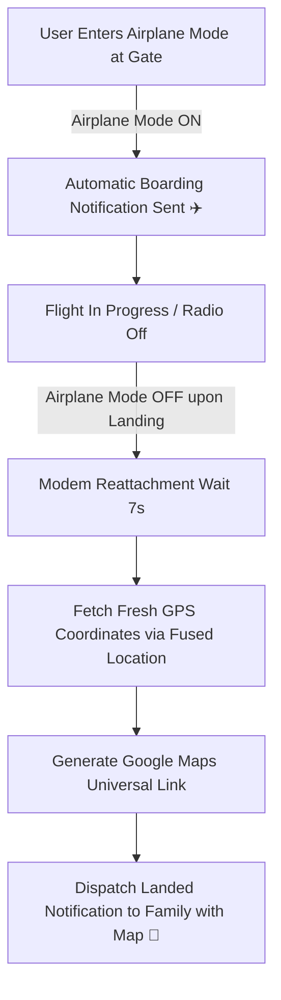

# ✈️ Smart Travel Mode

**Automatic flight notifications for your family — safe, private, and effortless.**

Smart Travel Mode is an Android application designed for travelers who want peace of mind for themselves and their families. It monitors device airplane mode transitions and automatically dispatches boarding and landing notifications (with real-time GPS coordinates and a Google Maps link) to designated family contacts via SMS and Email.

---

## 🚀 Download & Installation

### Option 1: Direct APK Download
- **Latest Release**: [v1.0.0](https://github.com/aravindbala03112003/smart-travel-mode/releases/tag/v1.0.0)
- **Direct APK Download**: [Download Smart Travel Mode APK (v1.0.0)](https://github.com/aravindbala03112003/smart-travel-mode/releases/download/v1.0.0/app-release.apk)
- **APK SHA-256**: `D3102BFED1718D6A7794567E9FC2D3C2AC1D339511816D2276C1B73C587EF92A`

### Installation Steps on Android:
1. Download `app-release.apk` on your Android phone using your browser.
2. If prompted, tap **Settings** and enable **"Allow from this source"** for your browser.
3. Tap **Install** and open **Smart Travel Mode**.
4. Grant the required permissions (Location and SMS) to allow the app to fetch your landing position and send notifications.
5. Enter your family member's phone number and email address, toggle your desired notification channels, and tap the floating **Save** button (⚙️).

---

## 🎯 How It Works



1. **Boarding Alert**:
   - When you board your flight and switch your phone to **Airplane Mode ON**, the app instantly triggers a boarding notification:
     > *"Boarding flight ✈️ – will be unreachable until landing."*
2. **Landing Alert with Real-Time Location**:
   - When your flight touches down and you toggle **Airplane Mode OFF**, the app waits 7 seconds for cellular modem reattachment, captures fresh GPS coordinates via Google Play Services Fused Location Provider, and dispatches the landing alert:
     > *"Landed safely 🛬\n\nCoordinates: 12.971599, 77.594566\nOpen in Google Maps: https://maps.google.com/?q=12.971599,77.594566"*
3. **Works Offline / In Background**:
   - Runs locally on the phone using standard Android platform broadcasts and telephony managers.

---

## 🛠️ Features & Configuration

- **SMS Notifications**: Automated multipart SMS dispatch through the active SIM subscription with delivery status tracking.
- **Email Notifications**: Seamless email composition targeting family email addresses.
- **GPS Location Card**: Dynamic in-app card displaying coordinates and clickable Google Maps link with `Linkify`.
- **Test Mode**: Dedicated `🧪 TEST NOTIFICATIONS` button to verify SMS and Email delivery before your trip.
- **Settings Persistence**: Secure local persistence (`SharedPreferences`) for family contact details and toggles.
- **Material 3 / Material Design UI**: Responsive layout featuring status cards with dynamic color coding (Blue: Ready, Orange: Boarding, Green: Landed).

---

## 🔒 Permissions & Security

| Permission | Purpose |
| :--- | :--- |
| `android.permission.SEND_SMS` | Dispatches SMS flight alerts directly to designated family phone numbers. |
| `android.permission.ACCESS_FINE_LOCATION` | Captures high-accuracy GPS coordinates upon flight landing. |
| `android.permission.ACCESS_COARSE_LOCATION` | Provides network-based location fallback if GPS is acquiring satellite lock. |
| `android.permission.INTERNET` | Resolves Google Maps URLs and delivers email intents. |

**Privacy Policy Guarantee**:
- No user accounts or logins required.
- Zero analytics, trackers, or telemetry.
- No third-party servers; all messages and coordinates are transmitted directly through your phone's cellular network and email client.

---

## 💻 Tech Stack & Architecture

- **Language**: Java 17
- **Target SDK**: Android 14 (API 34)
- **Minimum SDK**: Android 7.0 (API 24)
- **Build System**: Gradle 8.13 with Android Gradle Plugin 8.12.2
- **Key Libraries**:
  - AndroidX Core, AppCompat, ConstraintLayout, Material Components
  - Google Play Services Location (`com.google.android.gms:play-services-location:21.0.1`)
  - ViewBinding & DataBinding

---

## 🏗️ Building from Source

### Prerequisites:
- JDK 17 or JDK 21 (OpenJDK / Android Studio JBR)
- Android SDK with Platform 34 and Build Tools 35.0.0+

### Clone & Build:
```bash
git clone https://github.com/aravindbala03112003/smart-travel-mode.git
cd smart-travel-mode

# Build Debug APK
./gradlew assembleDebug

# Run Unit Tests
./gradlew testDebugUnitTest

# Run Lint Analysis
./gradlew lintDebug
```

### Release Signing:
Copy `keystore.properties.example` to `keystore.properties` and specify your release keystore parameters:
```properties
storeFile=your-release-key.jks
storePassword=your_store_password
keyAlias=your_key_alias
keyPassword=your_key_password
```
Then build the release APK:
```bash
./gradlew assembleRelease
```
The signed APK will be generated at `app/build/outputs/apk/release/app-release.apk`.

---

## 📄 License
This project is licensed under the Apache 2.0 License.
